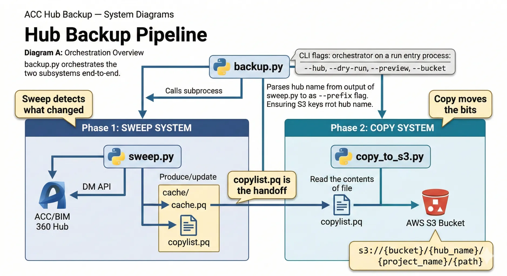
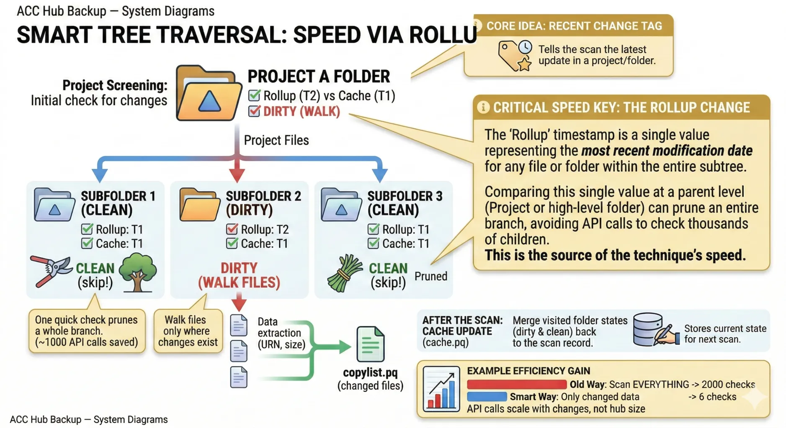
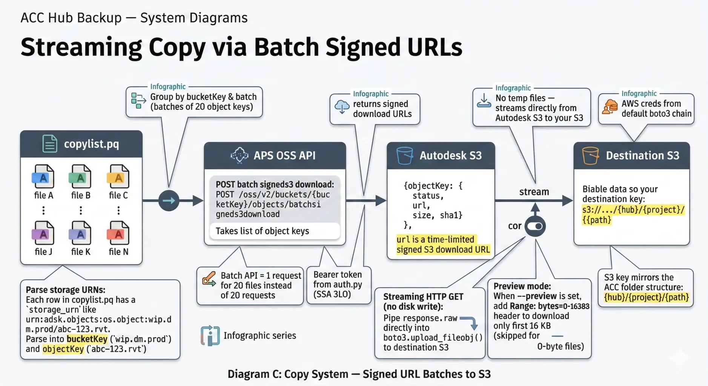

# ACC Hub Backup — System Diagrams

Four diagrams for an infographic explaining how the backup pipeline works.

---

## Diagram A: Orchestration Overview



**Title:** "Hub Backup Pipeline"

**Purpose:** Show how `backup.py` orchestrates the two subsystems end-to-end.

**Layout:** Left-to-right flow with two major blocks.

```
backup.py (orchestrator)
    |
    |  Phase 1                          Phase 2
    |  ┌─────────────────────┐          ┌─────────────────────┐
    +─>│   SWEEP SYSTEM      │          │   COPY SYSTEM       │
       │                     │          │                     │
       │   sweep.py          │          │   copy_to_s3.py     │
       │       |             │          │       |             │
       │       v             │          │       v             │
       │  ┌──────────┐       │   feed   │  ┌──────────┐      │
       │  │ cache.pq │       │ -------> │  │copylist.pq│     │
       │  └──────────┘       │          │  └──────────┘      │
       │                     │          │       |             │
       │  ACC/BIM 360 Hub    │          │       v             │
       │  (DM API)           │          │  AWS S3 Bucket      │
       └─────────────────────┘          └─────────────────────┘
```

**Key elements to show:**

1. **backup.py** at the top as the entry point with CLI flags (`--hub`, `--dry-run`, `--preview`, `--bucket`)
2. **Arrow down to Phase 1 — Sweep System**: backup.py calls `sweep.py` as a subprocess. sweep.py talks to the ACC hub via DM API and produces/updates two parquet files in `cache/`
3. **Arrow from cache/copylist.pq to Phase 2 — Copy System**: backup.py then calls `copy_to_s3.py`, which reads `copylist.pq` and uploads files to S3
4. **Hub name flows through**: backup.py parses the hub name from sweep's output and passes it as `--prefix` to copy_to_s3.py, so S3 keys are rooted at the hub name
5. Show the S3 key structure: `s3://{bucket}/{hub_name}/{project_name}/{path}`

**Callouts:**
- "Sweep detects what changed" (left block)
- "Copy moves the bits" (right block)
- "copylist.pq is the handoff" (connecting arrow)

---

## Diagram B: Sweep System — Cache & Dirty-Branch Pruning



**Title:** "Smart Tree Traversal with Rollup Cache"

**Purpose:** Explain how `lastModifiedTimeRollup` lets sweep.py skip unchanged branches, dramatically reducing API calls.

**Layout:** A tree diagram showing selective traversal with a side-by-side cache comparison.

```
                    Hub
                     |
          ┌──────────┼──────────┐
          |          |          |
       Project A  Project B  Project C
       rollup=T1  rollup=T2  rollup=T2
       cached=T1  cached=T1  (new)
          |          |          |
        CLEAN      DIRTY      DIRTY
       (skip!)    (walk)      (walk)
                     |
              ┌──────┼──────┐
              |      |      |
           Folder   Folder  Folder
           X        Y       Z
           T2       T1      T2
           T1       T1      (new)
            |        |        |
          DIRTY    CLEAN    DIRTY
          (walk)  (skip!)   (walk)
            |                 |
         [files]           [files]
            |                 |
            v                 v
         copylist.pq (only changed files)
```

**Key elements to show:**

1. **Phase 0 — Project Screening**: For each project, fetch the root "Project Files" folder. Compare its `lastModifiedTimeRollup` against cache.pq. If they match, the entire project is skipped (CLEAN). This one check eliminates all API calls for that project's subtree.

2. **Phase 1 — Branch Pruning**: For dirty projects, walk subfolders recursively. At each level, compare the subfolder's `lastModifiedTimeRollup` to cache. Matching = prune the entire branch (CLEAN). Mismatched or missing = continue walking (DIRTY).

3. **Phase 2 — File Collection**: Only at dirty leaf folders, fetch file items and extract `storage_urn` + `size_bytes` from the tip version's storage relationship. These go into copylist.pq.

4. **Cache Update**: After traversal, all visited folder states (dirty and clean) are written back to cache.pq, merging with untouched rows from clean projects.

**Callouts:**
- "rollup = latest modification timestamp across the entire subtree"
- "One timestamp comparison prunes thousands of folders"
- "API calls scale with changes, not with hub size"
- Example: "Hub with 50 projects, 2 dirty = ~6 API calls instead of ~2,000"

---

## Diagram C: Copy System — Signed URL Batches to S3



**Title:** "Streaming Copy via Batch Signed URLs"

**Purpose:** Explain how copy_to_s3.py reads the copylist, gets signed download URLs in batches, and streams files to S3 without touching disk.

**Layout:** Left-to-right pipeline flow.

```
 copylist.pq                APS OSS API               Autodesk S3         Destination S3
 ┌──────────┐              ┌─────────────┐            ┌──────────┐        ┌──────────┐
 │ file A   │  group by    │ POST batch  │  returns   │ signed   │ stream │ s3://... │
 │ file B   │  bucket key  │ signeds3    │  signed    │ download │------->│ /{hub}/  │
 │ file C   │ -----------> │ download    │  URLs      │ URLs     │        │ /{proj}/ │
 │ ...      │  (batches    │             │ -------->  │          │        │ /{path}  │
 │ file N   │   of 20)     │ per bucket  │            │          │        │          │
 └──────────┘              └─────────────┘            └──────────┘        └──────────┘
```

**Key elements to show:**

1. **Parse storage URNs**: Each row in copylist.pq has a `storage_urn` like `urn:adsk.objects:os.object:wip.dm.prod/abc-123.rvt`. Parse into `bucketKey` (`wip.dm.prod`) and `objectKey` (`abc-123.rvt`).

2. **Group & Batch**: Group files by bucket key. Within each group, batch up to 20 object keys per request to the OSS API endpoint: `POST /oss/v2/buckets/{bucketKey}/objects/batchsigneds3download`

3. **Signed URL Response**: API returns a map of `{objectKey: {status, url, size, sha1}}`. The `url` is a time-limited signed S3 download URL pointing to Autodesk's internal S3 storage.

4. **Stream to S3**: For each signed URL, open a streaming HTTP GET (no disk write). Pipe `response.raw` directly into `boto3.upload_fileobj()` to the destination S3 bucket. S3 key = `{hub_name}/{project_name}/{path}`.

5. **Preview mode**: When `--preview` is set, add `Range: bytes=0-16383` header to download only first 16 KB of each file (skipped for 0-byte files). Useful for quick validation without transferring full file sizes.

**Callouts:**
- "No temp files — streams directly from Autodesk S3 to your S3"
- "Batch API = 1 request for 20 files instead of 20 requests"
- "Bearer token from auth.py (SSA 3LO), AWS creds from default boto3 chain"
- "S3 key mirrors the ACC folder structure: {hub}/{project}/{path}"

---

## Diagram D: Webhook Listener — Move & Delete Tracking

**Title:** "Departure Events → Removals Log → S3 Cleanup"

**Purpose:** Explain how `webhook_listener.py` captures move/delete events from ACC webhooks and writes them to `removals.pq`, which `backup.py` would consume to clean up orphaned S3 keys.

**Layout:** Top-down flow showing the webhook trigger, the listener, and how removals.pq feeds back into the backup pipeline.

```
  ACC Hub (user action)
  ┌─────────────────────────────────────────────────────┐
  │  User moves folder          User deletes file       │
  │  A/B/Models → A/C/Models    A/B/report.pdf          │
  └──────────┬────────────────────────┬─────────────────┘
             │                        │
             v                        v
  APS Webhooks Service
  ┌─────────────────────────────────────────────────────┐
  │  dm.folder.moved.out          dm.version.deleted    │
  │  dm.version.moved.out         dm.folder.deleted     │
  │                                                     │
  │  payload:                                           │
  │    resourceUrn, ancestors[], project, tenant        │
  │    x-adsk-delivery-id, x-adsk-signature             │
  └──────────────────────┬──────────────────────────────┘
                         │ POST /callback
                         v
  webhook_listener.py
  ┌─────────────────────────────────────────────────────┐
  │  1. Verify HMAC-SHA1 signature (WEBHOOK_SECRET)     │
  │  2. Reconstruct old path from ancestors[]           │
  │     [Project Files, Structural, Models] → path      │
  │  3. Deduplicate by delivery_id                      │
  │  4. Append row to removals.pq                       │
  │                                                     │
  │  Runs as: Lambda / Flask dev server                 │
  └──────────────────────┬──────────────────────────────┘
                         │
                         v
  cache/removals.pq
  ┌─────────────────────────────────────────────────────┐
  │ timestamp | event_type          | old_path          │
  │ --------- | ------------------- | ----------------- │
  │ 2026-03-03| dm.folder.moved.out | PF/Struct/Models  │
  │ 2026-03-03| dm.version.deleted  | PF/Struct/rpt.pdf │
  └──────────────────────┬──────────────────────────────┘
                         │
                         v (consumed at next backup run)
  backup.py (future cleanup pass)
  ┌─────────────────────────────────────────────────────┐
  │  1. Read removals.pq                                │
  │  2. Delete stale S3 prefixes                        │
  │     s3://{bucket}/{hub}/PF/Struct/Models/*  → DEL   │
  │     s3://{bucket}/{hub}/PF/Struct/rpt.pdf   → DEL   │
  │  3. Remove entries from cache.pq                    │
  │  4. Truncate removals.pq                            │
  │  5. Continue with normal sweep + copy               │
  └─────────────────────────────────────────────────────┘
```

**Key elements to show:**

1. **Trigger**: A user action in ACC (move or delete) fires a webhook event. The four departure-side events (`*.moved.out`, `*.deleted`) are the ones that matter — they tell us *what left which path*.

2. **Payload → Path**: The webhook payload includes an `ancestors` array listing parent folders bottom-up. The listener reverses this to reconstruct the full old path (e.g. `Project Files/Structural/Models`).

3. **Safety layers**: HMAC-SHA1 signature verification prevents spoofed callbacks. Delivery ID deduplication handles APS retries. S3 Bucket Versioning makes cleanup mistakes recoverable.

4. **Parquet as the handoff**: Just as `copylist.pq` connects sweep → copy, `removals.pq` connects the webhook listener → backup cleanup. Same pattern, same format (parquet), same `cache/` directory.

5. **Asynchronous decoupling**: The webhook listener runs independently (Lambda, always-on). It just appends rows. The backup script reads and drains the log on its own schedule (daily cron, on-demand). No tight coupling.

**Callouts:**
- "Moves and deletes are the same problem: something left this path"
- "The listener only records departures — arrivals are handled by the sweep"
- "removals.pq is the handoff, just like copylist.pq"
- "S3 versioning makes cleanup safe — deleted objects are recoverable"
